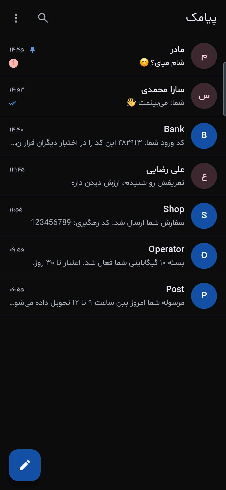
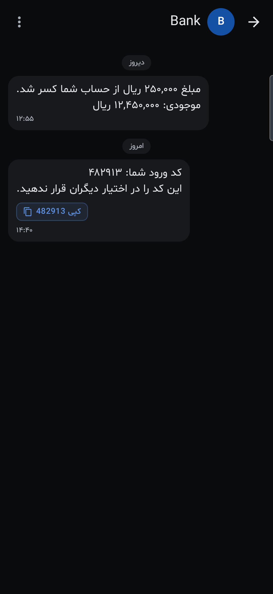
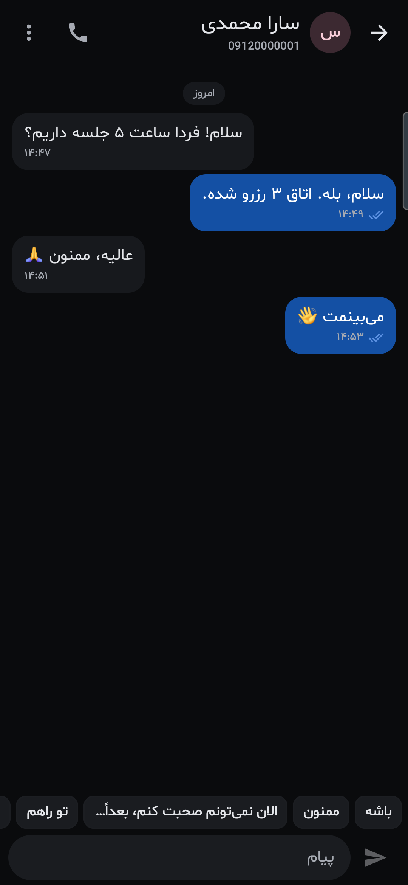
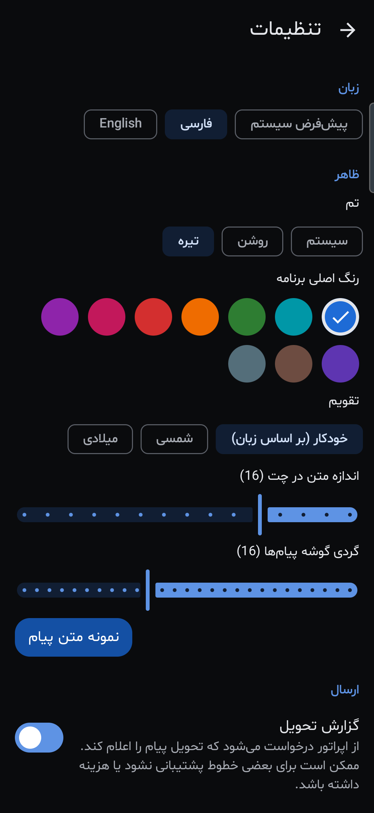

# Messages — SMS Messenger for Android

[](https://github.com/TheRealAliz/sms-messenger/actions/workflows/build.yml)
[](https://github.com/TheRealAliz/sms-messenger/releases)
[](LICENSE)
[](https://developer.android.com/about/versions/oreo)

A privacy-friendly SMS client for Android, written in Kotlin with Jetpack Compose.
It handles everyday texting well, in English and Persian (RTL), without ads,
analytics, accounts, or telemetry.

<p align="center">
  
  
  
  
</p>

## Features

- **SMS, done properly** — multipart messages, delivery reports, dual-SIM support,
  and the Android default-SMS role so messages arrive reliably.
- **Smart one-time codes** — detects verification codes in incoming messages and
  offers a one-tap copy chip, ignoring dates and USSD codes. Optional auto-copy.
- **Quick replies** — editable phrases above the composer in every conversation.
- **Conversation tools** — pin, archive, block, report spam, mute, star messages,
  and a trash with configurable automatic cleanup.
- **Privacy controls** — per-conversation locks plus an optional whole-app lock,
  backed by biometrics with a PIN fallback. Notification previews can be hidden.
- **Clean, familiar UI** — Material 3, light/dark theme, accent colour, adjustable
  bubble shape and text size.
- **English and Persian** — full RTL layout and Persian digits, with a Jalali or
  Gregorian calendar.
- **Links and previews** — tappable links and USSD codes, plus link previews for
  messages that contain a URL.
- **No cloud** — everything is stored locally in a Room database.

## Screenshots

| Conversations | One-time codes | Chat | Settings |
| --- | --- | --- | --- |
|  |  |  |  |

The screenshots use fictional demo data.

## Requirements

- Android 8.0 (API 26) or newer
- A device with telephony for sending and receiving SMS
- For building: JDK 17, Android SDK Platform 35, and the Android build tools

## Install

1. Download the latest `sms-messenger-*.apk` from
   [Releases](https://github.com/TheRealAliz/sms-messenger/releases).
2. Allow installation from your browser or file manager when prompted.
3. Open the app and choose **Set as default** so it can receive SMS and send
   delivery reports. Android only delivers `SMS_DELIVER` broadcasts to the
   default SMS app.
4. Grant the contacts permission if you want names and photos instead of numbers.

Verify the download with the published checksum:

```bash
sha256sum -c sms-messenger-0.9.0.apk.sha256
```

## Build from source

```bash
git clone https://github.com/TheRealAliz/sms-messenger.git
cd sms-messenger
./gradlew assembleDebug
```

The debug APK is written to `app/build/outputs/apk/debug/app-debug.apk`.
Debug builds use the application ID `com.tamadon.smsmessenger.debug`, so they can
be installed next to a release build.

For a release build, create `keystore.properties` from
[`keystore.properties.example`](keystore.properties.example) and point it at your
own keystore, then run:

```bash
./gradlew assembleRelease
```

Without `keystore.properties` the release build still runs but produces an
unsigned APK.

### Tests and checks

```bash
./gradlew test          # JVM unit tests
./gradlew lintDebug     # Android Lint
```

## Configuration

There are no API keys, server URLs, or environment variables. Everything the app
needs is configured in the UI:

- **Default SMS role** — required for incoming messages and delivery reports.
- **Permissions** — SMS and phone state are needed for core messaging; contacts
  and notifications are optional.
- **SIM** — choose the default sending SIM or let the system decide.
- **Language, theme, accent, calendar, text size** — under Settings.
- **Delivery reports** — depends on carrier support; some carriers charge for them.

## Privacy

- No accounts, analytics, advertising, crash reporting, or telemetry.
- Messages, contacts, and settings stay on the device in a local database and
  `SharedPreferences`.
- `INTERNET` is used only to fetch link previews (Open Graph metadata and images)
  for URLs that appear in messages. Nothing else leaves the phone.
- Conversations can be locked individually or the whole app can be locked with
  biometrics and a PIN.
- The app does not upload backups. Android backup is disabled.

## Limitations

- MMS and RCS are not implemented. The MMS receiver exists only because the
  default-SMS role requires it.
- Messages received before Messages became the default SMS app are imported from
  the system SMS provider on first run; messages received while another app was
  default may need a manual refresh.
- Group messaging is not supported.
- Delivery reports depend on the carrier.
- Link previews require an internet connection and a reachable URL.

## Project structure

```
app/src/main/java/com/tamadon/smsmessenger/
├── App.kt                  Application setup, database, repository
├── core/                   SMS sending/receiving, contacts, notifications, parsing
├── data/                   Room entities and DAO, preferences, provider sync
└── ui/                     Compose screens, navigation, theme, lock screen
```

See [`docs/architecture.md`](docs/architecture.md) for the data flow.

## Contributing

Contributions are welcome. Please read [`CONTRIBUTING.md`](CONTRIBUTING.md) and
the [`CODE_OF_CONDUCT.md`](CODE_OF_CONDUCT.md) first. For security issues, follow
[`SECURITY.md`](SECURITY.md) instead of opening a public issue.

## License

Copyright 2026 TheRealAliz and contributors.

Licensed under the [Apache License, Version 2.0](LICENSE). See
[`THIRD_PARTY_NOTICES.md`](THIRD_PARTY_NOTICES.md) for bundled components and the
Shabnam font license in [`licenses/Shabnam-OFL.txt`](licenses/Shabnam-OFL.txt).
